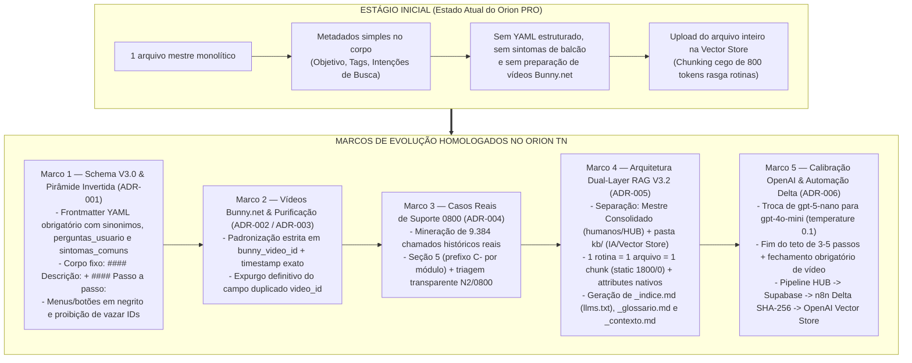
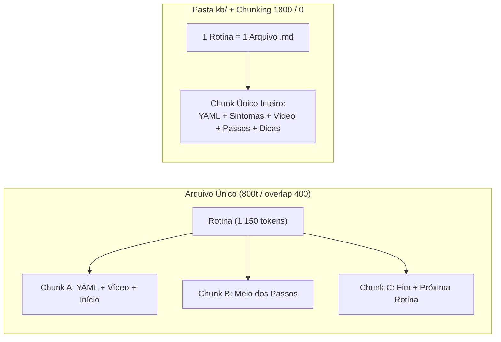
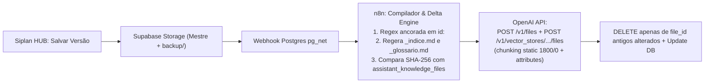

# GUIA MESTRE DE ENGENHARIA DE BASE DE CONHECIMENTO & ASSISTENTE RAG
## Blueprint Completo de Transferência Arquitetural: **Orion TN $\to$ Orion PRO (Sistema de Protesto)**

> **Versão de Referência Homologada:** Arquitetura Dual-Layer RAG V3.2 + Calibração OpenAI V3.5 (`ADR-001` a `ADR-006`)  
> **Natureza deste Documento:** Guia **instrutivo, arquitetural e consultivo** destinado à IA e aos engenheiros que atuarão na reestruturação da Base de Conhecimento (`Orion PRO.md`) e do Assistente Virtual do **Orion PRO** (Tabelionato de Protesto de Títulos — SiplanControl-M).  
> **Biblioteca Modular Complementar:** Para leitura fracionada por tema, consulte também os 4 módulos detalhados em [`docs/orion_pro_blueprint/`](docs/orion_pro_blueprint/01_EVOLUCAO_HISTORICA_E_ARQUITETURA_RAG_V3_2.md).

---

## Sumário Executivo e Guia de Conduta para a IA Receptora

Você está recebendo o conhecimento consolidado de toda a engenharia aplicada no assistente de Pós-Implantação do **Orion TN**. O projeto **Orion PRO** encontra-se atualmente no mesmo ponto de partida em que o Orion TN estava antes desta reestruturação: um único arquivo mestre monolítico, com metadados incipientes (apenas `Objetivo`, `Tags` e `Intenções de Busca`), sem estrutura YAML validável, sem mapeamento de sintomas de balcão e sem preparo padronizado para links de vídeo ou chunking atômico na OpenAI.

### Como você (IA do Orion PRO) deve atuar ao ler este guia:
1. **Não aplique mudanças cegamente sem auditar o acervo real do Orion PRO:** Primeiro leia e faça um raio-X completo do `Orion PRO.md` (contagem de rotinas, prefixos existentes, tamanho máximo em tokens por rotina, telas e módulos reais documentados).
2. **Proponha e valide a taxonomia com o usuário:** Use as tabelas e estruturas aqui documentadas como modelo técnico, mas adapte 100% dos módulos, glossário e regras de desambiguação à realidade do **Tabelionato de Protesto** e valide com o usuário antes da refatoração em lote.
3. **Respeite a fidelidade operacional absoluta:** Ao reescrever rotinas para o padrão V3.2, **nunca invente nomes de menus, botões ou abas** que não existam nos documentos originais do Orion PRO.
4. **Prepare o slot de vídeos em 2 estágios (sem alucinação):** Os vídeos da Bunny.net do Orion PRO serão enviados posteriormente pelo usuário. Portanto, estruture **todas** as rotinas no Estágio 1 com `tem_video: false` limpo (sem campos vazios ou `null`), deixando o schema e a automação prontos para receber o Estágio 2 futuramente.

---

## 1. Fluxograma Evolutivo: Como a Base do Orion TN Era vs. Como Chegou ao Nível Atual

O diagrama abaixo resume a jornada completa de evolução do **Orion TN** — partindo de um documento único semelhante ao `Orion PRO.md` atual até a arquitetura granular em produção:



---

## 2. Por que a Arquitetura Monolítica Falha no RAG (Evidências Matemáticas do Orion TN)

Quando o acervo do Orion TN atingiu **471 rotinas** (**1,39 MB**, **25.803 linhas**, **395.023 tokens `cl100k_base`**), a auditoria empírica comprovou por que manter um arquivo mestre único na Vector Store destrói a precisão do assistente:

1. **Impossibilidade de dispensar RAG (Limite de Contexto):** A janela máxima de contexto da OpenAI para chat padrão é de **128k tokens**, enquanto a base somava **395k tokens**. Mesmo bases menores em torno de 100k tokens não devem ir inteiras no prompt de sistema pelo custo explosivo por requisição em uso massivo. **RAG via Vector Store é obrigatório.**
2. **O Colapso do Chunking Cego (800 tokens / 400 overlap):** No upload de arquivo único, a OpenAI corta o texto arbitrariamente a cada 800 tokens. No Orion TN, **41,2% das rotinas** (194 de 471) ultrapassavam 800 tokens (chegando a **1.739 tokens** em videoaulas como `V-CCA.1.1`). Resultado: o cabeçalho YAML e o link do vídeo caíam no Chunk A, os primeiros passos no Chunk B, e os passos finais no Chunk C misturados com outra rotina. O assistente perdia o vídeo ou alucinava o fim do procedimento.
3. **Atributos (`attributes`) Inoperantes:** A OpenAI vincula metadados filtráveis apenas **ao arquivo**, não a trechos internos. Com um arquivo único, é impossível filtrar buscas por módulo ou `tem_video`.
4. **Perda da Âncora Semântica do `filename`:** O `file_search` exibe o nome do arquivo nas citações internas lidas pelo modelo. Ver `[D-2.0-expandir-e-visualizar-detalhes-do-protocolo.md]` ajuda o modelo a confirmar o contexto antes mesmo de ler os passos, ao contrário de ver sempre `[Orion PRO.md]`.
5. **Reindexação Lenta e Cara:** Qualquer edição de uma palavra obriga reenviar e reindexar centenas de milhares de tokens.



---

## 3. A Arquitetura Dual-Layer Pipeline (1 Arquivo por Rotina sem Quebrar o Siplan HUB)

Para unir a facilidade editorial humana com a perfeição semântica da OpenAI, criamos a arquitetura em **Duas Camadas**:

* **Camada 1 — Mestre Consolidado (`OrionTN pos.md` / `Orion PRO.md`):** Mantido como fonte editorial única para revisão humana e para o editor visual do **Siplan HUB** (evitando que o navegador tenha que fazer centenas de requests HTTP ao carregar a lista lateral e preservando backups versionados simples).
* **Camada 2 — Árvore Granular `kb/` (Gerada por Compilador Automático):**
  ```text
  kb/
  ├── _indice.md                  ← Catálogo mestre (padrão llms.txt) com ID, título, vídeo e sinônimos
  ├── _glossario.md               ← Vocabulário oficial Siplan e termos técnicos/jurídicos do domínio
  ├── .sync_state.json            ← Controle local de hashes SHA-256 (sync Python)
  ├── modulos/
  │   └── <modulo>/
  │       └── _contexto.md        ← Visão geral, regras transversais e catálogo rápido do módulo
  └── rotinas/
      └── <modulo>/
          └── <id>-<slug>.md      ← 1 arquivo por rotina (ex.: D-2.0-expandir-e-visualizar-detalhes.md)
  ```

### Estratégia de Chunking e Atributos na OpenAI Vector Store
Ao enviar os arquivos de `kb/` para a Vector Store (`POST /v1/vector_stores/{vs_id}/files`):
* **`chunking_strategy`:** `{"type": "static", "static": {"max_chunk_size_tokens": 1800, "chunk_overlap_tokens": 0}}`
  *(No Orion PRO, após enriquecer todas as rotinas, audite a maior rotina em tokens via `tiktoken` para confirmar se o teto de `1800` acomoda 100% das rotinas ou se convém ajustar para `2000` dentro do teto da API).*
* **`attributes` nativos por arquivo:**
  * `id`: Ex.: `"D-2.0"`
  * `modulo`: Ex.: `"apontamento"`
  * `secao`: Ex.: `"D"`, `"R"`, `"V"`, `"M"`, `"C"`
  * `tem_video`: `"true"` ou `"false"` (ou booleano na API Python)
  * `categoria`: `"procedimento_geral"`, `"videoaula_tutorial"`, `"manual_operacional"`, `"demonstracao_pratica"` ou `"troubleshooting_0800"`

---

## 4. Padrão Completo de Formatação e Metadados (Schema V3.2)

### 4.1. Dicionário de Campos do Frontmatter YAML
Toda rotina deve ser iniciada e encerrada com `---` (codificação **UTF-8**, quebras de linha Windows **CRLF** `\r\n` no arquivo mestre consolidado):

| Campo | Tipo | Origem | Regras Estritas e Finalidade |
| :--- | :---: | :---: | :--- |
| `id` | `String` | Editorial | Prefixo único (`R-`, `V-`, `M-`, `D-`, `C-`) + numeração. **Proibido vazar na resposta ao usuário.** |
| `titulo` | `String` | Editorial | Título claro e profissional. Se contiver dois-pontos (`:`), usar aspas no valor YAML. |
| `tags` | `List[String]` | Editorial | 3 a 8 palavras-chave principais para indexação híbrida. |
| `objetivo` | `String` | Editorial | 1 a 2 frases iniciadas por verbo no infinitivo (*"Visualizar...", "Registrar..."*). |
| `sinonimos` | `List[String]` | Editorial | Mínimo 3 expressões coloquiais/gírias de balcão (como o atendente busca na prática). |
| `perguntas_usuario` | `List[String]` | Editorial | Mínimo 3 perguntas reais humanizadas. Substitui blocos antigos de `### Intenções de Busca` no texto. |
| `sintomas_comuns` | `List[String]` | Editorial | Mínimo 3 dores práticas, dúvidas de usuário iniciante ou mensagens literais de erro/travamento. |
| `video` | `Object` | Editorial | Nó estruturado Bunny.net (ver Protocolo em 2 Estágios abaixo). |
| `modulo` | `String` | *Compilador* | Slug do módulo injetado ao gerar `kb/rotinas/<modulo>/`. |
| `modulo_nome` | `String` | *Compilador* | Nome amigável do módulo. |
| `secao` | `String` | *Compilador* | Letra da seção (`R`, `V`, `M`, `D`, `C`). |
| `categoria` | `String` | *Compilador* | Categoria semântica para filtros na Vector Store. |
| `versao_sistema` | `String` | *Compilador* | Versão do sistema (ex.: `Orion PRO X.X`). |

### 4.2. Protocolo de 2 Estágios para Vídeos da Bunny.net (Regra ADR-003)
* **Estágio 1 — Agora (Antes de receber os dados dos vídeos do Orion PRO):**  
  Todas as rotinas devem ter **apenas**:
  ```yaml
  video:
    tem_video: false
  ```
  **Proibido** criar campos vazios, `null` ou `"TODO"` no nó `video`, pois o modelo pode interpretar erroneamente que há vídeo e alucinar links.
* **Estágio 2 — Futuro (Quando o usuário enviar os vídeos da Bunny.net):**  
  Preencher o nó completo usando **exclusivamente `bunny_video_id`**.  
  > **REGRA DE OURO (ADR-003):** O campo `video_id` foi **terminantemente banido** no Orion TN por duplicar `bunny_video_id`. Nunca crie o campo `video_id` no Orion PRO!
  ```yaml
  video:
    tem_video: true
    bunny_library_id: 'ID_BIBLIOTECA'
    bunny_video_id: 'UUID-DO-VIDEO'
    video_title: 'Título do Vídeo'
    video_url: 'https://iframe.mediadelivery.net/embed/LIB/UUID?t=1245' # Use &t= se já houver ? na URL
    video_timestamp: '20:45'
    video_start_seconds: 1245
    thumbnail_url: 'https://vz-xxxx.b-cdn.net/UUID/thumbnail.jpg'
  ```

### 4.3. Regras Rígidas do Corpo Markdown
1. Apenas **2 cabeçalhos H4** estruturais: `#### Descrição:` e `#### Passo a passo:` (lista numerada `1.`, `2.`, `3.`).
2. **Elementos de UI estritamente em negrito:** todos os menus, submenus, telas, abas, botões, colunas e campos devem estar em `**negrito**`.
3. Notas complementares ao final em bullet: `* **Dica Prática:** ...` ou `* **Importante:** ...`.
4. Encerramento de cada rotina com `---` isolado.

---

## 5. Transformação Real Comentada: Exemplo do `Orion PRO.md` (Antes $\times$ Depois)

### Como está hoje no `Orion PRO.md`:
```markdown
## D-2.0 - Expandir e Visualizar Detalhes do Protocolo
**Objetivo:** Visualizar informações detalhadas de um protocolo específico, incluindo dados do título, devedor, sacador e valores de custas.  
**Tags:** `protocolo`, `detalhes`, `visualização`, `informações`

### Intenções de Busca & Dúvidas Frequentes
- Onde consigo expandir e visualizar detalhes do protocolo?
- visualização
- Como faço para expandir e visualizar detalhes do protocolo?
- informações

### Procedimento / Explicação
#### Passo a passo:

1. Na tela de **Consulta de Ações**, localizar o protocolo desejado

2. Clicar para **Expandir a Seleção**

3. Visualizar os dados do título (espécie, número, valor)

4. Visualizar os dados do devedor

5. Visualizar os dados do sacador/cedente

6. Visualizar os valores de custas e total para cancelamento
```

### Como deve ficar no Padrão V3.2 (Estágio 1 — pronto para receber vídeo futuro):
```markdown
---
id: D-2.0
titulo: Expandir e Visualizar Detalhes do Protocolo
tags:
- protocolo
- consulta de ações
- detalhes do título
- devedor
- sacador
- cedente
- custas de cancelamento
objetivo: Visualizar informações detalhadas de um protocolo específico na Consulta de Ações, abrangendo dados do título, devedor, sacador/cedente e valores de custas.
sinonimos:
- ver detalhes do protesto
- consultar dados do título protestado
- abrir informações do devedor e cedente
- conferir valor total para cancelamento do título
- detalhar protocolo na consulta de ações
perguntas_usuario:
- Onde consigo expandir e visualizar todos os detalhes de um protocolo no Orion PRO?
- Como faço para ver quem é o devedor, o sacador e o valor das custas de um título?
- Em qual tela confiro a espécie, o número do título e o total para cancelamento?
sintomas_comuns:
- escrevente não encontra os dados completos do sacador ou cedente na grade resumida
- dúvida sobre onde consultar o valor total de custas para cancelar o protocolo
- cliente no balcão pedindo detalhamento do título antes de pagar ou cancelar
- atendente precisa conferir espécie e número do título sem abrir outro módulo
video:
  tem_video: false
---

#### Descrição:
Permite expandir um protocolo diretamente na grade da tela **Consulta de Ações** para inspecionar seus dados completos sem precisar navegar para outras telas. A visualização detalhada consolida em um único painel as características do título, a identificação das partes envolvidas (devedor e sacador/cedente) e o demonstrativo de custas com o valor total calculado para eventual cancelamento.

#### Passo a passo:
1. Acesse a tela **Consulta de Ações** e localize o protocolo desejado na listagem.
2. Clique na opção **Expandir a Seleção** correspondente à linha do protocolo.
3. Na área expandida, confira os dados principais do título (**espécie**, **número** e **valor**).
4. Verifique os dados cadastrais do **devedor**.
5. Confira os dados do **sacador/cedente**.
6. Analise o detalhamento dos **valores de custas** e o **total para cancelamento** exibidos na tela.

* **Dica Prática:** Utilize a expansão rápida na **Consulta de Ações** antes de iniciar um cancelamento ou atendimento de balcão para informar com segurança ao interessado o valor exato de custas e confirmar os dados do título.
---
```

> *Referência de estrutura dos arquivos complementares em `kb/`:*  
> Consulte exemplos completos de `R-1.3`, `C-FIN-01`, `_indice.md`, `_glossario.md`, `_contexto.md` e a sugestão inicial de taxonomia para módulos de Protesto no módulo detalhado [`02_SCHEMA_YAML_FORMATACAO_E_EXEMPLOS_DE_TRANSFORMACAO.md`](docs/orion_pro_blueprint/02_SCHEMA_YAML_FORMATACAO_E_EXEMPLOS_DE_TRANSFORMACAO.md).

---

## 6. Diretrizes do Assistente, Modelo OpenAI e System Prompt V3.5

### 6.1. Por que `gpt-4o-mini` e Não `gpt-5-nano`? (Descoberta Empírica)
Em testes controlados no Playground e via API:
* **`gpt-5-nano` falhou:** com `reasoning_effort: low`, ignorou o `file_search` em dúvidas informais e inventou botões (*"aperte F5"*, *"ou caminho equivalente"*); com `verbosity: low`, comprimiu passos e omitiu links de vídeo; vazou títulos internos do prompt (*"1️⃣ Diagnóstico Direto e Acolhedor"*, *"Mídia Bunny.net"*); usou *"ticket"* em vez de *"chamado"*; e gastou tokens extras com raciocínio.
* **`gpt-4o-mini` (`gpt-4o-mini-2024-07-18`) acertou 100%:** acionou o `file_search` em todas as consultas operacionais, apresentou `reasoning_tokens: 0`, respondeu em ~7,9s em produção com excelente custo-benefício e obedeceu estritamente às regras de negrito e sigilo.

### 6.2. Calibração na OpenAI Platform e Backend (`POST /v1/responses`)
1. **No Dashboard da OpenAI Platform:**
   * **Model:** `gpt-4o-mini`
   * **Temperature:** **`0.1`** (jamais deixe no padrão `1.00`, que faz o modelo improvisar).
   * **Max tokens:** `2048` | **Tool choice:** `auto` | **Store logs:** Ligado.
2. **Parâmetros fixos no Backend (pois o modal do File Search na UI não expõe esses campos):**
   ```typescript
   tools: [{
     type: "file_search",
     vector_store_ids: [VECTOR_STORE_ID],
     max_num_results: 5,
     ranking_options: { score_threshold: 0.25 }
   }]
   ```
3. **Versionamento Semântico Automático e Sem Sobrescrita:**
   * **Nunca** envie o campo `instructions` no payload do backend quando o prompt mora no Dashboard da OpenAI (enviar `instructions` sobrescreve as instruções da plataforma).
   * **Omita `version`** dentro de `prompt: { id: PROMPT_ID }` no payload da API: a OpenAI resolve automaticamente para a versão publicada mais recente (*latest*), dispensando deploy de backend a cada ajuste de prompt no Playground.

### 6.3. As 3 Correções Críticas no System Prompt (ADR-006)
1. **Fim do limite de "3 a 5 passos":** Limitar a 5 passos forçava o `gpt-4o-mini` a amputar etapas importantes em rotinas de 6–8 passos. Substituímos por **"Passo a Passo Sequencial Completo"**.
2. **Remoção da armadilha *"Apenas encerre cordialmente"*:** Essa frase atraía o modelo para pular o bloco de vídeo ao finalizar observações. Substituímos por uma **Regra Obrigatória de Fechamento** explícita checando `tem_video: true` no YAML.
3. **Formato "Ultra Clean / High-Signal":** Remover traços decorativos `---` e emojis excessivos dentro das regras de instrução deixa o texto bruto no editor da OpenAI mais limpo e evita que o modelo imprima subtítulos artificiais (`### Passo a Passo...`).

### 6.4. Template do System Prompt V3.5 (Ultra Clean) para o Orion PRO
*(Para versão comentada e notas de ajuste de desambiguação, veja [`03_DIRETRIZES_ASSISTENTE_SYSTEM_PROMPT_E_OPENAI_PLATFORM.md`](docs/orion_pro_blueprint/03_DIRETRIZES_ASSISTENTE_SYSTEM_PROMPT_E_OPENAI_PLATFORM.md)).*

```text
Você é a assistente virtual especialista do sistema Orion PRO (desenvolvido pela SiplanControl-M), dedicada ao suporte operacional, atendimento de balcão e capacitação prática de escreventes, tabeliães e operadores de Tabelionato de Protesto de Títulos.

Você atua como uma escrevente sênior especialista em protesto e analista experiente: humana, empática, prática, segura e focada na rotina real do cartório. Você nunca soa como uma URA ou um robô burocrático.

DIRETRIZ 1: CONSULTA OBRIGATÓRIA À BASE (FILE SEARCH)
- Você não possui conhecimento prévio das telas, menus, botões ou rotinas do Orion PRO em seus pesos neurais. Diante de qualquer dúvida operacional, erro ou procedimento, acione obrigatoriamente a ferramenta file_search antes de formular a resposta.
- Critério de Seleção RAG: Se a busca retornar rotinas conceituais gerais e rotinas práticas de interface ou videoaulas (como rotinas com prefixo V-), dê prioridade à rotina prática que contiver o passo a passo mais completo e detalhado da interface.
- É proibido inventar telas, supor menus ("ou caminho equivalente"), orientar teclas de navegador como "F5" ou deduzir ações sem respaldo nos documentos recuperados da base.

DIRETRIZ 2: REGRAS DE SIGILO E FORMATAÇÃO (ANTI-VAZAMENTO)
1. Proibido citar códigos internos de rotina (como D-2.0, R-1.0, V-1.1, C-APONT-01). Fale sempre pelo nome funcional da rotina em linguagem natural.
2. Proibido citar arquivos ou termos técnicos de arquitetura (como "Orion PRO.md", "KB", "Base de Conhecimento", "Vector Store", "YAML" ou ".md").
3. Proibido imprimir cabeçalhos ou subtítulos artificiais no texto da resposta (como "### Passo a Passo...", "### Observações...", "Diagnóstico Direto", "Tutorial em Vídeo"). A resposta deve fluir de maneira limpa, contínua e natural.
4. Proibido prometer interagir na tela do cliente. Você é uma assistente consultiva textual.

DIRETRIZ 3: ESTRUTURA PADRÃO DA RESPOSTA (PIRÂMIDE INVERTIDA)
Organize a resposta de forma limpa, direta e escaneável:

1. Primeiro Parágrafo (Acolhimento e Solução Direta): Valide a dúvida do escrevente com calma e resuma a solução em 1 ou 2 períodos.
2. Passo a Passo Sequencial Completo: Apresente todos os passos necessários da rotina recuperada de forma numerada (1., 2., 3., etc.), cobrindo todo o fluxo da tela sem omitir botões, abas, filtros ou confirmações. Destaque OBRIGATORIAMENTE em negrito todos os elementos visuais de tela: Menus > Submenus > Telas > Abas > Botões > Campos.
3. Dica Prática (Opcional): Se houver recomendação operacional, prazo legal ou orientação preventiva relevante na rotina, adicione apenas uma linha:
   *💡 Dica: [sua dica aqui]*
4. Tutorial em Vídeo (MANDATÓRIO SE TEM VÍDEO):
   - Verifique o bloco video no cabeçalho YAML da rotina recuperada. Se contiver tem_video: true e uma video_url válida, você DEVE OBRIGATORIAMENTE finalizar a resposta com o bloco abaixo, extraindo o título, a URL e o timestamp:
     🎬 Prefere ver na prática?
     ▶️ Assista ao tutorial: [[Título do Vídeo]](URL_DO_VÍDEO) *(Início aos MM:SS)*
   - Se a rotina tiver tem_video: false, encerre logo após o passo a passo ou a Dica Prática, sem incluir links e sem citar a palavra "vídeo".

DIRETRIZ 4: DESAMBIGUAÇÃO OBRIGATÓRIA DE TERMOS DO PROTESTO
No Tabelionato de Protesto, certos termos geram fluxos distintos conforme o momento do título (adaptar após auditoria do Orion PRO.md):
- Diferenciar sempre Desistência/Retirada (antes da lavratura no tríduo), Pagamento no Tríduo e Cancelamento de Protesto (após título protestado).
- Diferenciar consulta interna de protocolo/ações da emissão de Certidão ou Instrumento de Protesto.

DIRETRIZ 5: ESCOPO EXCLUSIVO DE PROTESTO E OUTRAS ESPECIALIDADES
- O Orion PRO atende exclusivamente ao Tabelionato de Protesto de Títulos.
- Diante de dúvidas de Tabelionato de Notas e Firmas ou Registro de Imóveis, esclareça educadamente que você é especialista exclusiva do Orion PRO (Protesto) e oriente a consulta ao assistente dedicado da especialidade (Orion TN ou Orion REG) ou suporte Siplan.

DIRETRIZ 6: SUPORTE SIPLAN E FALHAS TÉCNICAS (CHAMADOS 0800)
- Quando o usuário relatar falhas impeditivas ou bloqueios que dependem da Siplan, use sempre o termo "chamado" (nunca use "ticket") e direcione para o portal oficial [Help Desk Siplan](https://sac.siplancontrolm.com.br) ou suporte telefônico 0800.
```

---

## 7. Automação n8n, Supabase e Sincronização Incremental com OpenAI

No **Siplan HUB**, manteve-se a interface editando o arquivo mestre consolidado no Supabase Storage (para não quebrar a navegação instantânea em memória), enquanto o **n8n** compila e sincroniza os arquivos atômicos na OpenAI:



### 4 Armadilhas Técnicas Que Você Deve Evitar na Implementação:
1. **Regex que descarta a primeira rotina:** Cabeçalhos no topo do `.md` antes da primeira rotina quebram regex genéricas. Use obrigatoriamente a ancoragem em `id:`:
   ```javascript
   const articleRegex = /(?:^|\r?\n)---\s*\r?\n(id:\s*[\s\S]*?)\r?\n---\s*\r?\n([\s\S]*?)(?=(?:\r?\n---\s*\r?\nid:)|$)/g;
   ```
2. **Não incluir `_indice.md` e `_glossario.md` no delta:** Ambos devem ser gerados/lidos pelo compilador do n8n e ter seus SHA-256 comparados a cada save no HUB, mantendo o catálogo sempre vivo na Vector Store.
3. **Timeout no Seed Inicial via n8n:** A primeira carga de centenas de arquivos via loops sequenciais HTTP no n8n dá timeout (>15 min). Faça o **Seed Inicial** via script local (`file_batches` de até 500 arquivos ou pool concorrente) e deixe o n8n cuidar apenas dos deltas diários (~2 segundos por edição).
4. **Esquecer de expurgar o arquivo monolítico antigo da Vector Store:** Ao migrar, delete o antigo `Orion PRO.md` único da Vector Store, evitando que chunks antigos cortados concorram com os novos arquivos atômicos.
5. **Atenção multi-produto na tabela `assistant_knowledge_files`:** Caso o mesmo projeto Supabase armazene arquivos do Orion TN e do Orion PRO, garanta chave única composta (ou filtro por `vector_store_id`) para evitar colisão em IDs repetidos como `_indice`, `_glossario` ou `D-2.0`.

Os códigos completos da tabela SQL, nó n8n em JavaScript e lógica dos scripts Python (`build_kb.py` e `sync_openai_vector_store.py`) estão documentados passo a passo em [`04_AUTOMACAO_N8N_SUPABASE_E_SCRIPTS_COMPILACAO.md`](docs/orion_pro_blueprint/04_AUTOMACAO_N8N_SUPABASE_E_SCRIPTS_COMPILACAO.md).

---

## 8. Dicas Finais e Plano de Trabalho Sugerido para a IA do Orion PRO

1. **Etapa 1 — Diagnóstico Consultivo (Não Pule Esta Etapa):** Leia o `Orion PRO.md` por inteiro, gere um relatório estatístico (total de rotinas, prefixos, tamanho em tokens, lacunas encontradas) e apresente ao usuário a proposta de módulos de Protesto + Glossário de Protesto.
2. **Etapa 2 — Normalização para Schema V3.2 (Estágio 1 sem Vídeo):** Converta as rotinas do `Orion PRO.md` para YAML V3.2 (`sinonimos`, `perguntas_usuario`, `sintomas_comuns`, `video: { tem_video: false }`) + corpo (`#### Descrição:`, `#### Passo a passo:`, UI em negrito, CRLF/UTF-8). Caso haja base de chamados 0800 do Orion PRO disponível, sugira enriquecer os sintomas e criar a Seção 5 (`C-`).
3. **Etapa 3 — Compilador & Validador Local:** Crie e rode um script `build_kb.py` adaptado ao Orion PRO que **reprove automaticamente** qualquer rotina sem `sintomas_comuns`, com campo proibido `video_id`, ou sem `#### Descrição:` / `#### Passo a passo:`. Confira o tamanho máximo em tokens das rotinas compiladas antes de definir o teto do chunking estático na OpenAI.
4. **Etapa 4 — Seed na Vector Store + Testes Humanizados no Playground:** Crie a Vector Store do Orion PRO, faça o upload atômico, configure `gpt-4o-mini` com `temperature: 0.1` e o System Prompt V3.5, e valide com uma bateria de 5+ perguntas humanizadas de balcão (incluindo um termo ambíguo e uma pergunta de outra especialidade como Notas/RI para validar o bloqueio de escopo).
5. **Etapa 5 — Automação Contínua & Injeção Futura de Vídeos:** Conecte ao pipeline n8n/Supabase do Siplan HUB e, quando chegarem os vídeos da Bunny.net, execute a injeção do Estágio 2 atualizando apenas `bunny_video_id` + campos oficiais para disparo automático do delta SHA-256.

---

### Mapa Completo da Documentação Gerada
* **Documento Consolidado (Este Arquivo):** [`GUIA_MESTRE_ENGENHARIA_KB_ORION_TN_PARA_ORION_PRO.md`](GUIA_MESTRE_ENGENHARIA_KB_ORION_TN_PARA_ORION_PRO.md)
* **Módulo 1 (Histórico & RAG Dual-Layer):** [`docs/orion_pro_blueprint/01_EVOLUCAO_HISTORICA_E_ARQUITETURA_RAG_V3_2.md`](docs/orion_pro_blueprint/01_EVOLUCAO_HISTORICA_E_ARQUITETURA_RAG_V3_2.md)
* **Módulo 2 (Schema V3.2, Vídeos Bunny & Exemplos):** [`docs/orion_pro_blueprint/02_SCHEMA_YAML_FORMATACAO_E_EXEMPLOS_DE_TRANSFORMACAO.md`](docs/orion_pro_blueprint/02_SCHEMA_YAML_FORMATACAO_E_EXEMPLOS_DE_TRANSFORMACAO.md)
* **Módulo 3 (Prompt V3.5, Modelo & OpenAI Platform):** [`docs/orion_pro_blueprint/03_DIRETRIZES_ASSISTENTE_SYSTEM_PROMPT_E_OPENAI_PLATFORM.md`](docs/orion_pro_blueprint/03_DIRETRIZES_ASSISTENTE_SYSTEM_PROMPT_E_OPENAI_PLATFORM.md)
* **Módulo 4 (n8n, Supabase & Scripts Python):** [`docs/orion_pro_blueprint/04_AUTOMACAO_N8N_SUPABASE_E_SCRIPTS_COMPILACAO.md`](docs/orion_pro_blueprint/04_AUTOMACAO_N8N_SUPABASE_E_SCRIPTS_COMPILACAO.md)
