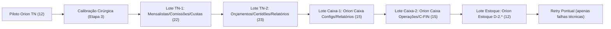

> **⚡ Diretriz de Execução**
> - **Modelo/Ferramenta:** `Gemini 4 Neon (High)` no coordenador (suporte multi-produto, calibração ADR-035 e consolidação) + subagent `Auditor de Rotinas Orion TN` para execução em lote do CLI.
> - **Degrau/Comando:** Degrau 2 (**Sub-agents**, obrigatório pela Golden Rule 8) — executar após aprovação final deste `/plan`.
> - **Cota/Contexto:** Risco **Médio** (6 lotes sequenciais via subagent com `--visual-mode defer`); manter retornos 100% em texto (zero `.png` no chat principal) e considerar `/compact` antes da Fase 5 (`notas`).

# Plano de Execução — Auditoria Visual Completa da Fase 4 (`caixa` — 105 Rotinas) Multi-Produto com Catálogo Nível 2.5

## Descrição do Objetivo e Baseline Verificado

Auditar de forma segura, incremental e verificável as **105 rotinas** de [`kb/rotinas/caixa/`](file:///d:/marcu/Videos/OrionTN/OrionTN/kb/rotinas/caixa) (`D-1.1` já validada na Fase 1 PoC → **104 rotinas restantes**), aproveitando o Catálogo Estrutural de Telas Nível 2.5 (`06.05.02`, 114 telas / 95 sub-estados / 777 botões / 2.202 campos) para as rotinas do **Orion TN** e habilitando a seleção real dos cards **Orion Caixa** e **Orion Estoque** no Portal Orion (`/webPortal/#/produtos`).

### Decisões Confirmadas pelo Usuário
1. **Seleção Multi-Produto no Portal Orion (`/webPortal/#/produtos`) — Opção 1 Confirmada:**
   Conforme a tela real de seleção de produtos do ambiente de homologação (`http://10.0.3.228:8601/webPortal/#/produtos`), o Portal Orion disponibiliza os **3 cards de produto**: **`Orion Caixa`**, **`Orion Estoque`** e **`Orion TN`**.
   
   - Pré-triar sem navegador apenas as **5 rotinas estritamente de hardware/Docker/scanner/SGA (Grupo B1)** como `[DDD]`.
   - Adicionar suporte cirúrgico a `--product "Orion TN" | "Orion Caixa" | "Orion Estoque"` no login/navegação do Portal (`config.ts`, `auth.ts`, `cli.ts`) e auditar **ao vivo todas as 99 rotinas web restantes diretamente em seu respectivo produto** (`57` no **Orion TN**, `30` no **Orion Caixa** e `12` no **Orion Estoque**).
2. **Modo Visual nos Lotes `--routines` — Confirmado (`--visual-mode defer`):**
   - Passar `--visual-mode defer` explicitamente no Piloto e em todos os lotes da Etapa 4 (alinhado ao padrão de `--phase` em [`agy-client.ts`](file:///d:/marcu/Videos/OrionTN/OrionTN/auditoria/src/agy-client.ts#L113-L129)), evitando chamadas síncronas de até 45s ao `agy.exe` e enfileirando casos residuais em `auditoria/cache/pending-som/`.

### Regras Inegociáveis Mantidas
- **Execução de navegador exclusiva via Subagent** (Golden Rule 8 — `TypeName: "self"`, `Role: "Auditor de Rotinas Orion TN"`).
- **Trava Segura de Mutação + Write-Through Supabase** (`--dry-run-mutations --headless`, sem `--no-sync`).
- **Evidência Estrita (ADR-017) e Anti-Colisão Semântica (ADR-035)**.
- **Zero imagens carregadas na conversa principal** durante a execução e **blindagem Git** (zero `.png`, `auditoria/auth/`, `session-*.json` ou `.env`).

---

## Distribuição Exata das 105 Rotinas de `kb/rotinas/caixa/` por Produto

Inspeção determinística de [`kb/rotinas/caixa/`](file:///d:/marcu/Videos/OrionTN/OrionTN/kb/rotinas/caixa) (`29` `read_only` + `76` `mutation`, total `105`):

| Grupo / Produto no Portal Orion | Qtd. | Estratégia de Execução | Composição |
|---|---:|---|---|
| **Fase 1 PoC (já validada)** | **1** | Preservada intacta | `D-1.1` (`validado_com_sucesso`) |
| **Grupo A1 — `Orion TN`** (`--product "Orion TN"`) | **57** | Ao vivo (Piloto `12` + TN-1 `22` + TN-2 `23`) com Catálogo L2.5 (`06.05.02`) | Mensalistas, Faturamento, Comissões, Formas de Pagamento, Movimentação Financeira, Orçamentos, Certidões, Custas, Relatórios, `D-3.*`, `M-*`, `V-*`, `C-FIN` no TN |
| **Grupo A2 — `Orion Caixa`** (`--product "Orion Caixa"`) | **30** | Ao vivo (Caixa-1 `15` + Caixa-2 `15`) entrando pelo card **Orion Caixa** | Trilha `D-1.2`–`D-1.23` (exceto `D-1.9`), `R-29.0` e casos `C-FIN` que operam no Orion Caixa |
| **Grupo A3 — `Orion Estoque`** (`--product "Orion Estoque"`) | **12** | Ao vivo (Lote Estoque `12`) entrando pelo card **Orion Estoque** | Trilha completa `D-2.1`–`D-2.14` (incluindo `D-2.1`, `D-2.5` Fornecedor e `D-2.13` Histórico de Aquisição) |
| **Grupo B1 — Hardware / Docker / SGA** | **5** | Pré-triagem `[DDD]` sem navegador (ADR-021) | `C-FIN-04`, `D-1.9`, `D-3.5`, `D-3.7`, `D-3.72` |
| **Total `kb/rotinas/caixa/`** | **105** | **0 duplicatas, 0 omissões** (`1` PoC + `99` navegador + `5` `[DDD]` pré-triado) | Soma acumulada Fases 1–4 = **273 rotinas** (`169 + 104`) |

---

## Mudanças e Etapas Propostas

### Etapa 1 — Pré-Triagem Offline, Pré-Triagem `[DDD]` (Grupo B1) e Suporte Multi-Produto no Portal Orion

#### [NEW] [pre-triagem-fase4-caixa.md](file:///d:/marcu/Videos/OrionTN/OrionTN/auditoria/mapeamento-telas/pre-triagem-fase4-caixa.md)
Mapa completo e determinístico das **105 rotinas** de `kb/rotinas/caixa/`, separando `D-1.1` (Fase 1 PoC), Grupo A1 (`Orion TN` — 57), Grupo A2 (`Orion Caixa` — 30), Grupo A3 (`Orion Estoque` — 12) e Grupo B1 (`[DDD]` hardware/Docker/scanner/SGA — 5), com carga (`read_only` vs. `mutation`), tela alvo no Catálogo L2.5 quando aplicável, verificação `step-scope.ts` (`[CCC]`) e divisão exata dos lotes.

#### [NEW] [phase4-hardware-pretriage.ts](file:///d:/marcu/Videos/OrionTN/OrionTN/auditoria/src/phase4-hardware-pretriage.ts)
Script determinístico para gerar os relatórios `[DDD]` sem navegador das **5 rotinas do Grupo B1** (`C-FIN-04`, `D-1.9`, `D-3.5`, `D-3.7`, `D-3.72`), reaproveitando `writePreTriagedDddReport` ([`hardware-pretriage.ts`](file:///d:/marcu/Videos/OrionTN/OrionTN/auditoria/src/hardware-pretriage.ts#L23-L97)) com write-through Supabase e proteção automática em `listHardwareRoutineIds` ([`hardware-registry.ts`](file:///d:/marcu/Videos/OrionTN/OrionTN/auditoria/src/hardware-registry.ts#L64-L71)).

#### [MODIFY] [config.ts](file:///d:/marcu/Videos/OrionTN/OrionTN/auditoria/src/config.ts)
Adicionar suporte a seleção de produto do Portal Orion com 100% de retrocompatibilidade (`default: 'Orion TN'`):
- Tipo `PortalProductName = 'Orion TN' | 'Orion Caixa' | 'Orion Estoque'`.
- Campos `portalProduct: PortalProductName` e função `setActivePortalProduct(product)` que define:
  - `Orion TN`: mantém exatamente `auditoria/auth/app-home.json` e fallback `/webFirmas/#/inicio`.
  - `Orion Caixa`: persiste a URL descoberta ao vivo em `auditoria/auth/app-home-orion-caixa.json` (gitignored em `auditoria/auth/`), sem derivar `/webFirmas`.
  - `Orion Estoque`: persiste a URL descoberta ao vivo em `auditoria/auth/app-home-orion-estoque.json` (gitignored em `auditoria/auth/`), sem derivar `/webFirmas`.

#### [MODIFY] [auth.ts](file:///d:/marcu/Videos/OrionTN/OrionTN/auditoria/src/auth.ts)
- Generalizar o clique no card de produto em `/webPortal/#/produtos` (atualmente hardcoded em `'Orion TN'` nas linhas 202–226) via helper `openPortalProductCard(client, config.portalProduct)`, suportando detecção de nova guia (`withNewTabDetection`) e persistindo a URL descoberta em `config.appHomeFile`.
- Em `isSessionActiveInPage(client)`: quando `config.portalProduct !== 'Orion TN'`, só considerar `where === 'orion_tn'` (sessão no módulo ativo) se a URL atual corresponder ao `discoveredModulePath()` do produto selecionado (evitando que uma sessão aberta em `/webFirmas` seja confundida com `/webCaixa` ou `/webEstoque`).
- Em `ensureAuthenticated(client)`: se `config.appHomeUrl` ainda não tiver sido descoberta para `Orion Caixa` ou `Orion Estoque`, navegar ao `/webPortal/#/produtos` reaproveitando a sessão SSO (ou efetuando login) e clicar no card correspondente.

#### [MODIFY] [cli.ts](file:///d:/marcu/Videos/OrionTN/OrionTN/auditoria/src/cli.ts)
- Aceitar flag opcional `--product "<Orion TN|Orion Caixa|Orion Estoque>"` (também via alias `orion-tn` / `orion-caixa` / `orion-estoque`), chamando `setActivePortalProduct(...)` no início de `main()` e imprimindo o produto ativo no banner de execução.

#### [NEW] [portal-product-selection.test.ts](file:///d:/marcu/Videos/OrionTN/OrionTN/auditoria/src/__tests__/portal-product-selection.test.ts)
Testes unitários offline garantindo:
- Padrão inalterado (`Orion TN` → `app-home.json`).
- Normalização e validação de `--product` para os 3 produtos (`Orion TN`, `Orion Caixa`, `Orion Estoque`).
- Isolamento dos arquivos `app-home-<slug>.json` dentro de `auditoria/auth/`.

*(Validação obrigatória antes da Etapa 2: `npm --prefix auditoria run typecheck` e `npm --prefix auditoria test` 100% verdes.)*

---

### Etapa 2 — Piloto A/B da Fase 4 (`12` Rotinas Representativas no `Orion TN` via Subagent)

Seleção de **12 rotinas representativas do Grupo A1 (`Orion TN`)** cobrindo `5` `read_only` + `7` `mutation` em telas financeiras do Catálogo Nível 2.5 (incluindo teste de menu legado `M-5.0` e sub-aba de `#/configuracoes` `M-16.11`):

| ID | Carga | Tela L2.5 Alvo | Papel no Piloto |
|---|---|---|---|
| `M-30.0` | `read_only` | `088` (`#/tipoPagamento`) | Consulta Formas de pagamento |
| `M-31.0` | `mutation` | `088` (`#/tipoPagamento` + modal `Adicionar`) | Cadastro Forma de pagamento (dry-run) |
| `M-64.0` | `read_only` | `102` (`#/tipoMovimentacaoFinanceira`) | Consulta Tipo de movimentação financeira |
| `M-65.0` | `mutation` | `102` (`#/tipoMovimentacaoFinanceira` + modal `Adicionar`) | Cadastro Tipo de movimentação (dry-run) |
| `M-1.0` | `mutation` | `064` (`#/mensalistas`) | Gerenciamento de Mensalistas |
| `M-4.0` | `mutation` | `063` (`#/mensalistaLancamentoManual`) | Lançamentos manuais de mensalistas |
| `M-48.0` | `mutation` | `062` (`#/filiais`) | Acessar e gerenciar Filiais |
| `R-19.0` | `mutation` | `039` (`#/plano`) | Plano de comissões (menu quase exato) |
| `M-5.0` | `read_only` | `039` (`#/plano`) | Menu legado (`Comissões > Planos`) |
| `D-3.10` | `read_only` | `008` (`#/servicoPraticado`) | Consulta Serviços praticados |
| `D-3.58` | `read_only` | `028` (`Relatórios > Recolhimento diário`) | Relatório de recolhimento |
| `M-16.11` | `mutation` | `110` (`#/configuracoes`, aba `Faturamento`) | Bridge L2.5 `reveal-explorer` + sinônimos |

**Delegação obrigatória ao Subagent (`TypeName: "self"`, `Role: "Auditor de Rotinas Orion TN"`):**
```powershell
npx tsx src/cli.ts --product "Orion TN" --routines M-30.0,M-31.0,M-64.0,M-65.0,M-1.0,M-4.0,M-48.0,R-19.0,M-5.0,D-3.10,D-3.58,M-16.11 --concurrency 3 --dry-run-mutations --headless --visual-mode defer
npx tsx src/verify-all-phase2-boxes.ts --only=M-30.0,M-31.0,M-64.0,M-65.0,M-1.0,M-4.0,M-48.0,R-19.0,M-5.0,D-3.10,D-3.58,M-16.11
```
*(Opcionalmente, antes dos Lotes Caixa-1/Estoque, executar um mini-smoke de 2 rotinas em `--product "Orion Caixa"` e `--product "Orion Estoque"`, ex.: `D-1.16` e `D-2.1`, para confirmar a descoberta da URL de ambos os cards no Portal antes de disparar os lotes completos desses produtos.)*

---

### Etapa 3 — Calibração Cirúrgica Pós-Piloto (Condicional — Apenas com Evidência do Piloto)

#### [MODIFY] [route-synonyms.ts](file:///d:/marcu/Videos/OrionTN/OrionTN/auditoria/src/route-synonyms.ts) *(somente se houver renomeação inequívoca comprovada no Piloto)*
#### [MODIFY] [menu-canonical.ts](file:///d:/marcu/Videos/OrionTN/OrionTN/auditoria/src/menu-canonical.ts) *(somente se o Piloto provar equivalência de menu financeiro/comissões/faturamento sem ambiguidade)*
#### [MODIFY] [triage-att-level25.test.ts](file:///d:/marcu/Videos/OrionTN/OrionTN/auditoria/src/__tests__/triage-att-level25.test.ts) *(cobertura ADR-035 para qualquer novo sinônimo contra `orion-screen-catalog.json`)*

Critérios rígidos desta etapa:
1. Só promover sinônimos inequívocos (mesmo papel funcional, zero colisão `th`/`heading` ↔ `field`, validado por teste unitário ADR-035).
2. Só ajustar comportamentos do motor (ex.: modal overlay bloqueando passo seguinte ou `isOptionsOnly` com sub-itens de campos) se ocorrer evidência concreta no Piloto da Fase 4.
3. Antes de liberar a Etapa 4, rodar `npm --prefix auditoria run typecheck` e `npm --prefix auditoria test` (e reexecutar apenas IDs do Piloto destravados pela calibração, se houver).

---

### Etapa 4 — Execução Completa da Fase 4 em 5 Lotes Seguros por Produto (via Subagent)

Execução sequencial via subagent `Auditor de Rotinas Orion TN` com `--concurrency 3 --dry-run-mutations --headless --visual-mode defer`, sempre seguida de `verify-all-phase2-boxes.ts --only=<ids-do-lote>`:



- **Lote TN-1 (`22` rotinas — `--product "Orion TN"`):**
  `M-2.0,M-3.0,M-33.1,M-33.2,M-33.3,M-49.0,D-3.61,D-3.62,D-3.63,D-3.64,D-3.65,M-6.0,M-7.0,M-16.9,D-3.55,D-3.49,C-FIN-02,C-FIN-06,C-FIN-09,C-FIN-13,C-FIN-14,D-7.0`
- **Lote TN-2 (`23` rotinas — `--product "Orion TN"`):**
  `D-3.13,V-2.3.3,V-2.4.3,D-3.4,D-3.17,D-3.18,M-14.4,M-17.0,M-18.0,M-53.0,D-3.50,D-3.53,D-3.54,D-3.57,D-3.59,D-3.66,D-3.67,D-3.68,D-3.69,D-3.73,D-3.76,R-31.0,R-35.0`
- **Lote Caixa-1 (`15` rotinas — `--product "Orion Caixa"`):**
  `D-1.2,D-1.3,D-1.4,D-1.5,D-1.6,D-1.7,D-1.8,D-1.10,D-1.11,D-1.12,D-1.13,D-1.14,D-1.15,D-1.16,D-1.17`
- **Lote Caixa-2 (`15` rotinas — `--product "Orion Caixa"`):**
  `D-1.18,D-1.19,D-1.20,D-1.21,D-1.22,D-1.23,R-29.0,C-FIN-01,C-FIN-03,C-FIN-05,C-FIN-07,C-FIN-08,C-FIN-10,C-FIN-11,C-FIN-12`
- **Lote Estoque (`12` rotinas — `--product "Orion Estoque"`):**
  `D-2.1,D-2.2,D-2.3,D-2.5,D-2.6,D-2.8,D-2.9,D-2.10,D-2.11,D-2.12,D-2.13,D-2.14`
- **Retry pontual:** ao final dos lotes, consolidar e reexecutar exclusivamente eventuais IDs com `falha_tecnica` (ou eventual rotina `C-FIN`/`D-1`/`D-2` que, após evidência ao vivo, se comprove pertencer a outro produto do Portal).

> [!NOTE]
> **Observação sobre o Catálogo `06.05.02` em `Orion Caixa` e `Orion Estoque`:** o motor lê sempre a **árvore de menus real do DOM ao vivo** em cada produto (`menu-path.ts` Camadas 1/2). Caso alguma rotina `Orion Caixa`/`Orion Estoque` falhe no menu, o relatório registrará o `Raio-X` real da árvore de menus do produto correspondente, sem gerar evidência falsa.

---

### Etapa 5 — Relatório Consolidado, Validação Global e Prontidão da Fase 5

#### [NEW] [resultado-fase4-caixa.md](file:///d:/marcu/Videos/OrionTN/OrionTN/auditoria/mapeamento-telas/resultado-fase4-caixa.md)
Relatório executivo contendo:
1. Placar completo da **Fase 4 (`105` rotinas de `caixa`)** por status (`validado_com_sucesso`, `validado_inalterado`, `validado_com_ajustes`, `[ATT]`, `[DDD]`, `[XRX]`, `[CCC]`, multi-tags e `falha_tecnica = 0`), detalhado por produto (`Orion TN` × `Orion Caixa` × `Orion Estoque` × `B1 Hardware`).
2. Placar acumulado das **Fases 1–4 (`273` rotinas = `169` anteriores + `104` novas de `caixa`)** por módulo, status primário e tag.
3. Resumo das evoluções aplicadas (suporte multi-produto `--product` + eventuais calibrações ADR-035 da Etapa 3) e prontidão exata para a **Fase 5 (`notas` — 166 rotinas)**.

---

## Plano de Verificação

### Testes Automatizados e Auditoria Geométrica
Ao final de cada etapa/lote e globalmente na Etapa 5:
1. `npm --prefix auditoria run typecheck` — esperado: **0 erros**.
2. `npm --prefix auditoria test` — esperado: **100% aprovados** (`> 345` testes, incluindo `portal-product-selection.test.ts` e novos testes ADR-035 da Etapa 3).
3. `npx --prefix auditoria tsx auditoria/src/verify-all-phase2-boxes.ts --only=<ids>` por lote e `--all` ao final — esperado: **0 discrepâncias** em 100% das prints (todos os 8 invariantes matemáticos, conferência inversa disco ↔ telemetria e zero pastas gêmeas ou `[!!!]`).
4. `git status -s` — esperado: **zero** `.png`, `auditoria/auth/`, `session-*.json` ou `.env` expostos/rastreados.

### Verificação Manual / Operacional
- Confirmar que `auditoria/rotinas/caixa/` contém exatamente **105 pastas** (`D-1.1` + 104 novas), sem duplicatas e com `falha_tecnica = 0`.
- Confirmar no retorno do subagent que os 3 produtos (`Orion TN`, `Orion Caixa`, `Orion Estoque`) autenticaram via Portal sem gravar mutações (`--dry-run-mutations`) e com write-through Supabase ativo.
