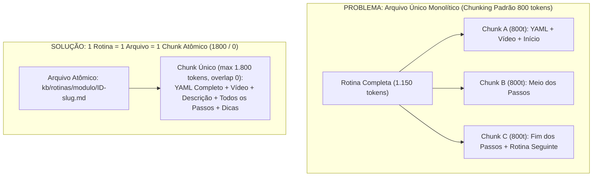

# 01. Evolução Histórica e Arquitetura RAG Dual-Layer V3.2 (Orion TN $\to$ Orion PRO)

> **Documento Modular 1 de 4 — Blueprint de Transferência de Engenharia de Conhecimento**  
> **Público-Alvo:** Agente de IA / Arquiteto de Conhecimento responsável pelo sistema **Orion PRO (Protesto de Títulos)**  
> **Objetivo deste Módulo:** Explicar a jornada completa de evolução da base de conhecimento do **Orion TN** (do estado "cru" inicial até a arquitetura granular RAG V3.2), os gargalos matemáticos descobertos em produção e como estruturar essa mesma arquitetura de forma consultiva no **Orion PRO**.

---

## 1. Contexto e Postura Recomendada para a IA do Orion PRO

Este documento não impõe alterações cegas sobre o acervo do **Orion PRO**. Ele transfere integralmente a engenharia, as lições aprendidas, os erros resolvidos e os padrões validados no **Orion TN**.

Antes de executar alterações em lote nos arquivos do Orion PRO, recomenda-se que a IA receptora:
1. **Audite o arquivo mestre atual (`Orion PRO.md`):** contabilize o número exato de rotinas, identifique os prefixos existentes (`D-`, `R-`, `V-`, `M-`, etc.), meça o tamanho total em bytes, linhas e tokens (`cl100k_base` / `o200k_base`), e verifique o tamanho máximo em tokens da maior rotina individual.
2. **Mapeie os domínios do Protesto de Títulos:** proponha ao usuário uma taxonomia de módulos e prefixos adaptada ao fluxo real do Tabelionato de Protesto (apontamento, intimação, edital, sustação, desistência/cancelamento, CENPROT/CRA, caixa/emolumentos, etc.).
3. **Alinhe a estratégia de implementação:** confirme com o usuário se haverá integração com o Siplan HUB / Supabase / n8n ou apenas geração local dos arquivos estruturados para upload na OpenAI Platform.

---

## 2. Linha do Tempo: Como a Base do Orion TN Evoluiu ("Antes vs. Depois")

A base do **Orion TN** partiu de um estágio inicial muito semelhante ao estado atual relatado no `Orion PRO.md`: um único arquivo consolidado, com metadados simples (`Objetivo`, `Tags`, `Intenções de Busca & Dúvidas Frequentes`), sem padronização rígida de YAML, sem mapeamento de dores reais de balcão e entregue como um "monolito único" na OpenAI Vector Store.

Abaixo está o fluxograma histórico de como cada versão resolveu um gargalo real de produção:

```mermaid
flowchart TD
    V1["Estágio Inicial (Legado V1 / V2)<br/>- 1 arquivo monolítico único<br/>- Sem YAML estruturado (apenas Título, Objetivo, Tags)<br/>- Sem sintomas de balcão ou links de vídeo padronizados"]
    V30["Marco 1: Schema YAML V3.0 & Pirâmide Invertida (ADR-001)<br/>- Frontmatter YAML rígido em 100% das rotinas<br/>- Inclusão obrigatória de sinonimos, perguntas_usuario e sintomas_comuns<br/>- Corpo fixo: #### Descrição: + #### Passo a passo:<br/>- Elementos de UI obrigatoriamente em negrito<br/>- Regra de Zero Vazamento de IDs internos"]
    V30W["Marco 2: Ingestão de Novidades & Padronização Bunny.net (ADR-002 / ADR-003)<br/>- Incorporação de transcrições de Webinars/Videoaulas<br/>- Expurgo do campo duplicado video_id<br/>- Padrão exclusivo bunny_video_id + timestamp exato"]
    V31["Marco 3: Mineração de Casos Reais 0800 (ADR-004)<br/>- Análise de 9.384 chamados reais do Service Desk<br/>- Criação da Seção 5 (prefixo C- com siglas temáticas)<br/>- Triagem transparente para N2/Banco de Dados vs desbloqueio em tela"]
    V32["Marco 4: Arquitetura Granular Dual-Layer RAG V3.2 (ADR-005)<br/>- Descoberta do colapso do chunking cego (800 tokens)<br/>- Separação em 2 camadas: Mestre Consolidado + Pasta kb/ atômica<br/>- Chunking estático 1800/0 (1 rotina = 1 arquivo = 1 chunk)<br/>- Índices de roteamento (_indice.md, _glossario.md, _contexto.md)"]
    V35["Marco 5: Calibração do Modelo, Prompt & Pipeline (ADR-006)<br/>- Migração de gpt-5-nano para gpt-4o-mini (temperature 0.1)<br/>- Fim da trava rígida de 3-5 passos + Garantia de vídeo<br/>- Pipeline automático Siplan HUB -> Supabase -> n8n -> OpenAI Delta SHA-256"]

    V1 --> V30 --> V30W --> V31 --> V32 --> V35
```



---

## 3. O Diagnóstico Matemático que Mudou Tudo (Por que o Arquivo Único Falha no RAG)

Na tentativa inicial de usar o arquivo único consolidado dentro da Vector Store da OpenAI, enfrentamos uma degradação silenciosa na qualidade das respostas. A auditoria empírica via tokenizador oficial (`tiktoken`) revelou a raiz matemática do problema.

### 3.1. Raio-X da Base Consolidada do Orion TN
Quando a base atingiu a maturidade (V3.1.0, 471 rotinas), apresentava os seguintes números:
* **Tamanho em disco:** `1.392.508 bytes` (~1,39 MB) | `25.803 linhas` (CRLF)
* **Total de tokens (`cl100k_base`):** `395.023 tokens` (`342.426 tokens` em `o200k_base`)
* **Distribuição por seção:**
  * Seção `R-` (Rotinas gerais): 43 rotinas — média de 758,1 tokens (mín 586 / máx 1.225)
  * Seção `V-` (Videoaulas): 110 rotinas — média de 1.149,7 tokens (mín 798 / **máx 1.739**)
  * Seção `M-` (Manuais): 100 rotinas — média de 806,0 tokens (mín 593 / máx 1.221)
  * Seção `D-` (Demonstrações/Caixa): 120 rotinas — média de 741,0 tokens (mín 597 / máx 1.551)
  * Seção `C-` (Casos Reais 0800): 98 rotinas — média de 669,3 tokens (mín 552 / máx 924)

> **Mito Desfeito (RAG vs. Full-Context Prompting):** Chegou-se a cogitar colocar a base inteira diretamente no prompt de sistema sem Vector Store. Como o limite da janela de contexto dos modelos de chat padrão é de **128k tokens** e a base já somava **395k tokens**, o RAG via Vector Store provou-se **tecnicamente obrigatório**. Além disso, passar centenas de milhares de tokens por requisição multiplicaria o custo por chamada em uso massivo.

### 3.2. Os 4 Defeitos Críticos do Monolito no `file_search` da OpenAI

1. **Chunking Cego (Fragmentação no Meio das Rotinas):**  
   A estratégia padrão (`auto`) da OpenAI Vector Store fatia arquivos longos em blocos de **800 tokens com overlap de 400 tokens**. Como **41,2% das rotinas** do Orion TN ultrapassavam 800 tokens, o corte ocorria no meio da rotina:
   * O cabeçalho YAML (`titulo`, `sinonimos`, `sintomas_comuns`, `video_url`) caía no **Chunk A**;
   * A descrição e os primeiros passos caíam no **Chunk B**;
   * O final dos passos e a dica caíam no **Chunk C**, misturados com a rotina seguinte!  
   *Resultado prático:* Ao recuperar apenas o Chunk B, o assistente tinha os passos mas **não enxergava o link do vídeo nem os sintomas**; ao recuperar o Chunk A, via o título mas tinha que "adivinhar" os botões finais.

2. **Impossibilidade de Filtragem por Atributos (`attributes`):**  
   Na API da OpenAI Vector Store, os metadados (`attributes`) são associados **ao arquivo inteiro**, nunca a pedaços internos. Com um arquivo único, era impossível filtrar buscas por módulo (`protocolo`, `intimacao`, `caixa`, etc.) ou por existência de vídeo (`tem_video`).

3. **Perda da Âncora Semântica do Nome do Arquivo (`filename`):**  
   Quando o `file_search` injeta resultados no contexto do LLM, ele exibe o nome do arquivo citado (`annotations` / `file_citation`). Com o monolito, o modelo via sempre `[OrionTN pos.md]`. Com arquivos individuais, o modelo lê `[V-7.6.1-importacao-reversa-de-minuta-word-com-extraca.md]` ou `[C-FIN-01-estorno-encadeado-de-recibo-com-guia-de-recolhimen.md]`, recebendo contexto semântico gratuito de qual módulo e tipo de rotina está lendo.

4. **Reindexação Lenta e Cara a Cada Edição:**  
   Qualquer correção de uma vírgula exigia reenviar 1,39 MB e reindexar ~395 mil tokens inteiros na OpenAI.



---

## 4. A Solução Definitiva: Arquitetura Dual-Layer Pipeline (V3.2)

Manter 400+ arquivos editados manualmente um por um no dia a dia por operadores humanos seria inviável (causaria lentidão no navegador ao abrir editores web e fragmentação do controle de versão). Por isso, adotou-se a **Arquitetura em Duas Camadas (Dual-Layer)**:

* **Camada 1 — Fonte da Verdade Humana / Editorial (Arquivo Mestre Consolidado):**  
  Um único arquivo mestre (no Orion TN: `doc conhecimento final/OrionTN pos.md`; no Orion PRO: o equivalente consolidado `Orion PRO.md`). É nele que revisores humanos e a interface do Siplan HUB navegam, pesquisam em memória instantaneamente, editam rotinas e geram backups versionados.
* **Camada 2 — Árvore Granular de Produção RAG (`kb/`):**  
  Uma árvore de arquivos gerada **automaticamente por compilador** (script Python local para ambiente de desenvolvimento e nó JavaScript no n8n para produção web), composta por:
  1. `kb/rotinas/<modulo>/<id>-<slug>.md`: **1 arquivo por rotina**, nunca editado na mão isoladamente sem refletir no mestre.
  2. `kb/_indice.md`: Catálogo mestre de roteamento semântico no padrão *llms.txt*, listando todos os módulos, IDs, títulos, presença de vídeo e sinônimos-chave em tabelas Markdown.
  3. `kb/_glossario.md`: Vocabulário controlado do ecossistema Siplan, termos jurídicos/cartorários e siglas oficiais (no Orion PRO: siglas de protesto como CENPROT, CRA, IEPTB, CDA, DMI, DSI, sustação, triplicata, etc.).
  4. `kb/modulos/<modulo>/_contexto.md`: Arquivo transversal por módulo funcional com visão geral, regras de negócio do módulo, desambiguações obrigatórias e catálogo rápido das rotinas vinculadas.

### 4.1. Calibração Matemática do Chunking na OpenAI Vector Store
No momento em que cada arquivo da pasta `kb/` é vinculado à Vector Store via API (`POST /v1/vector_stores/{vs_id}/files`), aplica-se a estratégia estática calibrada:

```json
{
  "chunking_strategy": {
    "type": "static",
    "static": {
      "max_chunk_size_tokens": 1800,
      "chunk_overlap_tokens": 0
    }
  }
}
```

**Por que 1800 tokens e 0 de overlap?**
* No Orion TN, a maior rotina de toda a base (`V-CCA.1.1`) tinha **1.739 tokens**.
* Ajustar o teto para `1800` tokens (o máximo permitido por chunk estático da OpenAI para arquivos de rotina com margem segura, podendo ser verificado contra o pico de tokens do `Orion PRO.md`) e `overlap: 0` garantiu matematicamente que **100% das rotinas virassem exatamente 1 único chunk atômico**.
* *Nota instrutiva para a IA do Orion PRO:* Ao auditar o `Orion PRO.md`, meça os tokens da maior rotina após o enriquecimento V3.2. Se alguma rotina exceder ~1.750 tokens, avalie quebrá-la em duas rotinas atômicas coesas ou ajustar `max_chunk_size_tokens` dentro do limite permitido pela API da OpenAI (até 4096 tokens na especificação da API de Vector Stores, embora 1800–2000 mantenha o contexto enxuto e econômico no retrieval).

### 4.2. Divisão por Seções Canônicas (Origem do Conhecimento)
No Orion TN, o acervo foi consolidado em **5 Seções Principais**, diferenciadas pelo prefixo do `id`:
* **Seção 1 (`R-`):** Rotinas operacionais gerais e novidades de versão (`procedimento_geral`).
* **Seção 2 (`V-`):** Transcrições purificadas de videoaulas e webinars com minutagem exata (`videoaula_tutorial`).
* **Seção 3 (`M-`):** Procedimentos extraídos de manuais de produto (`manual_operacional`).
* **Seção 4 (`D-`):** Demonstrações práticas de fluxo e balcão (`demonstracao_pratica`).
* **Seção 5 (`C-`):** Casos Reais de Suporte e Troubleshooting 0800 com sub-siglas temáticas por módulo (`troubleshooting_0800`), nascidos da mineração de 9.384 chamados reais do Service Desk.

---

## 5. Checklist de Auditoria Inicial Recomendado para o Orion PRO

Antes de iniciar a reescrita de qualquer rotina do `Orion PRO.md`, recomenda-se que a IA siga esta sequência consultiva com o usuário:

1. **Inventário Quantitativo:** Contar quantas rotinas existem hoje no `Orion PRO.md`, quais prefixos usam (como `D-2.0` do exemplo) e se há sobreposição ou lacunas de numeração.
2. **Mapeamento de Módulos do Protesto:** Propor a lista de módulos funcionais exclusivos do Orion PRO (sem copiar cegamente os módulos de Notas/Firmas do Orion TN).
3. **Definição de Glossário de Protesto:** Levantar siglas e termos próprios (CRA, CENPROT, SERASA/SPC, Protesto de Sentença, CDA, Edital Eletrônico, Carta de Anuência, Cancelamento Online, etc.) para evitar confusão fonética e melhorar o match do BM25.
4. **Confirmação de Escopo de Vídeos e Chamados 0800:** Confirmar com o usuário que todas as rotinas devem nascer com `tem_video: false` (aguardando a futura planilha/JSON de vídeos da Bunny.net) e verificar se há base histórica de chamados 0800 do Orion PRO para enriquecer `sintomas_comuns:` e criar futuros playbooks `C-`.
