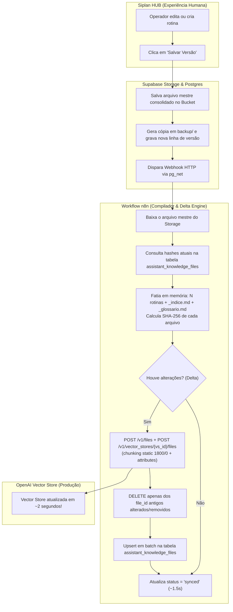

# 04. Automação n8n, Supabase e Scripts de Compilação/Sincronização (Orion TN $\to$ Orion PRO)

> **Documento Modular 4 de 4 — Blueprint de Transferência de Engenharia de Conhecimento**  
> **Público-Alvo:** Agente de IA / Arquiteto de Conhecimento responsável pelo sistema **Orion PRO (Protesto de Títulos)**  
> **Objetivo deste Módulo:** Documentar a infraestrutura de sincronização contínua validada no **Orion TN** (Siplan HUB + Supabase + n8n + OpenAI Vector Store API), os scripts Python locais de compilação/validação (`build_kb.py` e `sync_openai_vector_store.py`) e os 4 bugs críticos descobertos e corrigidos durante a implantação.

---

## 1. Arquitetura Híbrida (Siplan HUB + Supabase + n8n + OpenAI)

Quando o editor de base de conhecimento do **Siplan HUB** (`/assistentes/conhecimento`) foi integrado à nova arquitetura granular `kb/`, analisamos duas opções:
* **Opção Rejeitada (Arquivos Soltos no Storage):** Exigiria reescrever o frontend e faria o navegador disparar centenas de requisições HTTP ao abrir a tela.
* **Opção Homologada (Opção 1 — Compilador no Pipeline do Backend/n8n):** O operador humano continua visualizando, buscando e editando em um único arquivo consolidado no Siplan HUB (`Orion PRO.md` no Storage + cópias em `backup/`), enquanto o **n8n** atua em segundo plano como compilador automático para a OpenAI.



### Vantagens Práticas Comprovadas:
1. **Economia de 99,8% por edição:** Editar 1 rotina no HUB envia apenas ~1 arquivo (~2 KB) para a OpenAI em ~2 segundos, em vez de reindexar toda a base (~395k tokens).
2. **`_indice.md` e `_glossario.md` sempre vivos:** A cada salvamento no HUB, o compilador regera o `_indice.md` em memória, compara o hash SHA-256 e, caso haja mudança, envia a versão atualizada para a Vector Store automaticamente.

---

## 2. Schema da Tabela de Controle de Hashes no Supabase

Para saber com precisão cirúrgica quais rotinas mudaram entre um salvamento e outro, o Supabase utiliza a tabela `public.assistant_knowledge_files`:

```sql
-- Tabela de rastreamento granular (1 linha por arquivo atômico na Vector Store)
CREATE TABLE IF NOT EXISTS public.assistant_knowledge_files (
  id UUID PRIMARY KEY DEFAULT gen_random_uuid(),
  article_id TEXT NOT NULL UNIQUE,       -- Ex: 'D-2.0', '_indice', '_glossario'
  file_path TEXT NOT NULL,               -- Ex: 'kb/rotinas/apontamento/D-2.0-expandir-e-visualizar.md'
  file_name TEXT,
  modulo TEXT NOT NULL,
  secao TEXT NOT NULL,                   -- 'R', 'V', 'M', 'D', 'C', 'SYS'
  tem_video BOOLEAN NOT NULL DEFAULT false,
  categoria TEXT NOT NULL,
  sha256_hash TEXT NOT NULL,             -- Chave de comparação delta
  openai_file_id TEXT,                   -- ID na OpenAI Files API (file-...)
  vector_store_id TEXT,                  -- ID da Vector Store (vs_...)
  token_count INTEGER,
  sync_status TEXT NOT NULL DEFAULT 'synced',
  last_synced_at TIMESTAMPTZ DEFAULT now(),
  created_at TIMESTAMPTZ DEFAULT now(),
  updated_at TIMESTAMPTZ DEFAULT now()
);

CREATE INDEX IF NOT EXISTS idx_assistant_knowledge_files_article_id ON public.assistant_knowledge_files (article_id);
CREATE INDEX IF NOT EXISTS idx_assistant_knowledge_files_modulo ON public.assistant_knowledge_files (modulo);
CREATE INDEX IF NOT EXISTS idx_assistant_knowledge_files_sha256 ON public.assistant_knowledge_files (sha256_hash);

ALTER TABLE public.assistant_knowledge_files ENABLE ROW LEVEL SECURITY;

CREATE POLICY "Acesso leitura arquivos de conhecimento"
  ON public.assistant_knowledge_files FOR SELECT TO authenticated, anon USING (true);

CREATE POLICY "Modificação arquivos de conhecimento"
  ON public.assistant_knowledge_files FOR ALL TO service_role USING (true);
```
*(Recomendação aplicada no Orion TN: criar também uma função RPC `upsert_assistant_knowledge_file_batch(p_files JSONB)` para gravar centenas de registros em uma única chamada atômica após a carga inicial).*

*(Observação multi-produto: se a tabela `assistant_knowledge_files` do projeto Supabase vier a hospedar tanto **Orion TN** quanto **Orion PRO**, avalie com a equipe do Siplan HUB usar uma chave composta `(system_slug, article_id)` ou separar por `vector_store_id`, evitando colisão caso ambos os sistemas possuam IDs homônimos como `D-2.0` ou `_indice`!)*

---

## 3. Os 4 Bugs Críticos Resolvidos no Pipeline n8n + OpenAI

Ao migrar o workflow do n8n do Orion TN, enfrentamos e corrigimos 4 problemas que devem ser prevenidos desde o início no Orion PRO:

### 1. Bug da Regex que "Comia" a Primeira Rotina (`R-1.0`)
* **O Erro:** Usar regex genérica `/---\s*\n([\s\S]*?)\n---/` fazia o parser capturar o cabeçalho introdutório do arquivo mestre (antes da primeira rotina) como se fosse YAML, falhar o parse e descartar a primeira rotina inteira silenciosamente.
* **A Correção Homologada:** Ancorar explicitamente o início do bloco em `id:`:
  ```javascript
  const articleRegex = /(?:^|\r?\n)---\s*\r?\n(id:\s*[\s\S]*?)\r?\n---\s*\r?\n([\s\S]*?)(?=(?:\r?\n---\s*\r?\nid:)|$)/g;
  ```

### 2. Esquecimento de `_indice.md` e `_glossario.md` no Delta
* **O Erro:** Fatiar apenas as rotinas e esquecer os documentos estruturais faz com que o catálogo `_indice.md` na Vector Store fique desatualizado quando novas rotinas são criadas no HUB.
* **A Correção:** O nó compilador do n8n deve montar o `_indice.md` (tabela consolidada de IDs, títulos e sinônimos) e o `_glossario.md` em memória e incluí-los no array de arquivos submetidos ao cálculo SHA-256 (`article_id = '_indice'` e `article_id = '_glossario'`).

### 3. Timeout no Seed Inicial via n8n
* **O Problema:** No dia a dia (1 ou 2 rotinas alteradas), o loop HTTP no n8n leva ~2 segundos. Mas na **primeira carga (Seed)** de 300–500 rotinas, fazer ~900 requisições HTTP sequenciais (`POST /files` + `POST /vector_stores/.../files`) dentro do n8n ultrapassa facilmente 15 minutos e causa **timeout**.
* **A Solução:** Executar a carga inicial (*Seed*) via script com pool de concorrência (Node.js/Python com `file_batches` da OpenAI, que aceita até **500 arquivos por batch**) e popular a tabela `assistant_knowledge_files`. Depois disso, o n8n assume exclusivamente os deltas diários instantâneos.

### 4. Expurgo Obrigatório do Arquivo Monolítico Antigo
* **O Risco:** Se o antigo `Orion PRO.md` permanecer vinculado dentro da Vector Store após subir os arquivos granulares, os chunks quebrados antigos continuarão competindo na busca vetorial com os arquivos novos atômicos.
* **A Solução:** Executar rotina de limpeza (`--purge-old` no script de seed ou checagem no n8n) que desvincula e deleta qualquer arquivo da Vector Store que não faça parte do conjunto atômico atual.

---

## 4. Referência de Payload HTTP para a OpenAI Vector Store API

Ao vincular cada arquivo individual na Vector Store via API (usado tanto no n8n quanto em scripts):

1. **Upload do arquivo (`POST https://api.openai.com/v1/files`):** `multipart/form-data` com `purpose: "assistants"` e o arquivo `.md`.
2. **Vínculo à Vector Store (`POST https://api.openai.com/v1/vector_stores/{vs_id}/files`):**
   * Header obrigatório para endpoints v2 quando aplicável: `OpenAI-Beta: assistants=v2`
   * Body JSON:
   ```json
   {
     "file_id": "{{ $json.openai_file_id }}",
     "chunking_strategy": {
       "type": "static",
       "static": {
         "max_chunk_size_tokens": 1800,
         "chunk_overlap_tokens": 0
       }
     },
     "attributes": {
       "id": "{{ $json.attributes.id }}",
       "modulo": "{{ $json.attributes.modulo }}",
       "secao": "{{ $json.attributes.secao }}",
       "tem_video": "{{ $json.attributes.tem_video }}",
       "categoria": "{{ $json.attributes.categoria }}"
     }
   }
   ```
   *(Atenção: antes de fixar `1800`, verifique em tokens qual é o tamanho máximo de uma rotina do Orion PRO após enriquecimento para garantir que 100% delas caibam abaixo desse teto).*

---

## 5. Código de Referência: Nó Compilador & Delta do n8n (JavaScript)

Modelo homologado utilizado no workflow do Orion TN, pronto para ser adaptado às regras de classificação de módulos do **Orion PRO**:

```javascript
const crypto = require('crypto');
const yaml = require('js-yaml');

const rawContent = $input.first().binary.data
  ? Buffer.from($input.first().binary.data, 'base64').toString('utf8')
  : '';
if (!rawContent) throw new Error('Arquivo mestre vazio ou não recebido.');

const dbFiles = $('Consultar assistant_knowledge_files').all().map(item => item.json);
const dbFileMap = new Map(dbFiles.map(f => [f.article_id, f]));

// REGEX HOMOLOGADA (ancorada em id: para não perder a primeira rotina)
const articleRegex = /(?:^|\r?\n)---\s*\r?\n(id:\s*[\s\S]*?)\r?\n---\s*\r?\n([\s\S]*?)(?=(?:\r?\n---\s*\r?\nid:)|$)/g;

const compiledFiles = [];
let match;

while ((match = articleRegex.exec(rawContent)) !== null) {
  const frontmatterRaw = match[1];
  const body = match[2].trim();

  let meta = {};
  try {
    meta = yaml.load(frontmatterRaw) || {};
  } catch (e) {
    continue;
  }

  const id = String(meta.id || '').trim();
  if (!id) continue;

  const titulo = String(meta.titulo || '').trim();
  const tags = Array.isArray(meta.tags) ? meta.tags.map(String) : [];
  const temVideo = Boolean(meta.video && meta.video.tem_video);

  const secaoMatch = id.match(/^([A-Z])/i);
  const secao = secaoMatch ? secaoMatch[1].toUpperCase() : 'R';

  // TODO (Orion PRO): Adaptar regras regex de classificação de módulo conforme taxonomia de Protesto
  const combined = `${id} ${titulo} ${tags.join(' ')}`.toLowerCase();
  let modulo = 'geral';
  if (/(apontamento|protocolo|recep|distribuic)/i.test(combined)) modulo = 'apontamento';
  else if (/(intimac|edital|ar\b|portador|triduo)/i.test(combined)) modulo = 'intimacao';
  else if (/(lavratura|desist|cancelamento|sustac|anuenc)/i.test(combined)) modulo = 'lavratura';
  else if (/(cenprot|cra\b|ieptb|banco|remessa|retorno|serasa|spc)/i.test(combined)) modulo = 'centrais';
  else if (/(caixa|emolumento|custas|repasse|pagamento|recibo|mensalista)/i.test(combined)) modulo = 'caixa';
  else if (/(selo|livro|termo de abertura|termo de encerramento)/i.test(combined)) modulo = 'selos';
  else if (/(certid|busca|instrumento)/i.test(combined)) modulo = 'certidoes';
  else if (/(login|senha|usuario|perfil|permiss|2fa)/i.test(combined)) modulo = 'acesso';
  else if (/(config|parametro|tabela|impressora|feriado)/i.test(combined)) modulo = 'config';

  let categoria = 'procedimento_geral';
  if (temVideo || secao === 'V') categoria = 'videoaula_tutorial';
  else if (secao === 'M') categoria = 'manual_operacional';
  else if (secao === 'D') categoria = 'demonstracao_pratica';
  else if (secao === 'C' || tags.some(t => /0800|suporte|erro/i.test(t))) categoria = 'troubleshooting_0800';

  const slug = titulo.toLowerCase()
    .normalize('NFD').replace(/[\u0300-\u036f]/g, '')
    .replace(/[^a-z0-9]+/g, '-')
    .replace(/^-+|-+$/g, '')
    .slice(0, 45);

  const fileName = `${id}-${slug}.md`;
  const filePath = `kb/rotinas/${modulo}/${fileName}`;
  const fileContent = `---\n${frontmatterRaw.trim()}\n---\n\n${body}\n`;
  const sha256 = crypto.createHash('sha256').update(fileContent, 'utf8').digest('hex');

  compiledFiles.push({
    article_id: id,
    file_path: filePath,
    file_name: fileName,
    file_content: fileContent,
    sha256_hash: sha256,
    attributes: {
      id,
      modulo,
      secao,
      tem_video: temVideo ? 'true' : 'false',
      categoria
    }
  });
}

// Montar aqui também o _indice.md e o _glossario.md e adicioná-los ao compiledFiles!
// ...

// Comparador Delta (SHA-256)
const toUpload = [];
const toDelete = [];
const activeIds = new Set(compiledFiles.map(f => f.article_id));

for (const [artId, dbRec] of dbFileMap.entries()) {
  if (!activeIds.has(artId) && dbRec.openai_file_id) {
    toDelete.push({ article_id: artId, openai_file_id: dbRec.openai_file_id });
  }
}

for (const file of compiledFiles) {
  const existing = dbFileMap.get(file.article_id);
  if (!existing || existing.sha256_hash !== file.sha256_hash) {
    toUpload.push({
      ...file,
      old_openai_file_id: existing ? existing.openai_file_id : null,
      is_update: Boolean(existing)
    });
  }
}

return [{
  json: {
    total_compiled: compiledFiles.length,
    to_upload_count: toUpload.length,
    to_delete_count: toDelete.length,
    has_changes: toUpload.length > 0 || toDelete.length > 0,
    files_to_upload: toUpload,
    files_to_delete: toDelete
  }
}];
```

---

## 6. Scripts Python Locais de Compilação, Validação e Seed (`scripts/`)

Em ambiente local (antes mesmo de subir para produção ou quando houver edição em lote via IA), o repositório do Orion TN utiliza dois scripts Python essenciais que devem ser adaptados ao Orion PRO:

### 6.1. Lógica do Compilador/Validador (`build_kb.py`)
Responsabilidades obrigatórias antes de gerar os arquivos:
1. **Regex de fatiamento segura:** Captura todas as rotinas ancorando em `id:`.
2. **Validador de Schema V3.2 (Gatekeeper):** Reprova e aborta a compilação caso qualquer rotina viole as regras:
   * Campos ausentes: `id`, `titulo`, `tags` (mín. 2), `objetivo`, `sinonimos`, `perguntas_usuario`, `sintomas_comuns`, nó `video`.
   * **Bloqueio ADR-003:** Aborta com erro se o campo proibido `video_id` existir no nó `video`.
   * Se `video.tem_video == True`: exige `bunny_library_id`, `bunny_video_id`, `video_title`, `video_url`.
   * Corpo obrigatório: valida presença de `#### Descrição:` e `#### Passo a passo:`.
3. **Classificação de Módulos e Injeção de Metadados:** Injeta `modulo`, `modulo_nome`, `secao`, `categoria`, `versao_sistema` no YAML de cada arquivo em `kb/rotinas/<modulo>/`.
4. **Geração Automática dos Arquivos Auxiliares:** Gera `kb/_indice.md`, `kb/_glossario.md` e `kb/modulos/<modulo>/_contexto.md`.

### 6.2. Lógica do Sincronizador Incremental (`sync_openai_vector_store.py`)
1. Varre `kb/_indice.md`, `kb/_glossario.md`, `kb/modulos/*/_contexto.md` e `kb/rotinas/*/*.md`.
2. Calcula o SHA-256 de cada arquivo e compara com `kb/.sync_state.json`.
3. Suporta `--dry-run` (para validar quantos arquivos seriam enviados sem gastar API), `--vector-store-id <ID>` e `--force`.
4. Faz upload via `client.files.create(..., purpose="assistants")` e vincula em lote usando `client.vector_stores.file_batches.create_and_poll(...)` (suporta até 500 arquivos por batch) com `max_chunk_size_tokens: 1800`, `chunk_overlap_tokens: 0` e `attributes` nativos.
5. Remove da Vector Store os `file_id` antigos substituídos, evitando lixo vetorial.

---

## 7. Fluxo Futuro de Injeção de Vídeos Bunny.net (Estágio 2)

Quando o usuário disponibilizar os dados dos vídeos do Orion PRO na Bunny.net (planilha, JSON ou legendas `.vtt` com minutagem):
1. A IA do Orion PRO deverá correlacionar cada vídeo/timestamp à sua respectiva rotina no `Orion PRO.md` (ou criar novas rotinas `V-`).
2. Atualizará o nó `video:` de `tem_video: false` para `tem_video: true` preenchendo exclusivamente `bunny_library_id`, `bunny_video_id`, `video_title`, `video_url` (com `?t=` ou `&t=`), `video_timestamp`, `video_start_seconds` e `thumbnail_url` (**jamais** criando `video_id`).
3. Reexecutará a compilação (`build_kb.py`) ou salvará no Siplan HUB: o pipeline calculará os novos hashes SHA-256 e atualizará automaticamente apenas as rotinas modificadas na Vector Store, mudando o atributo `tem_video` de `"false"` para `"true"`.
